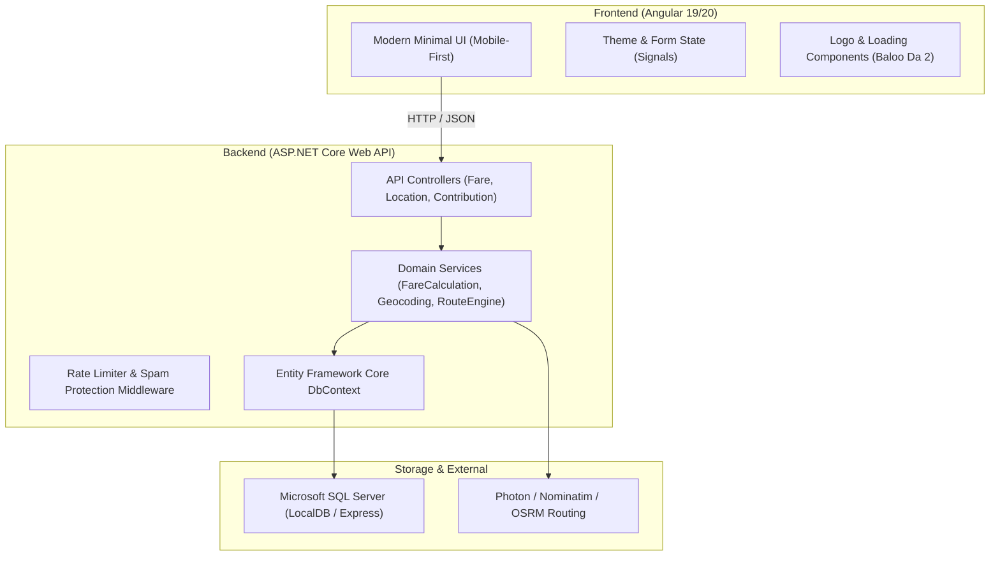
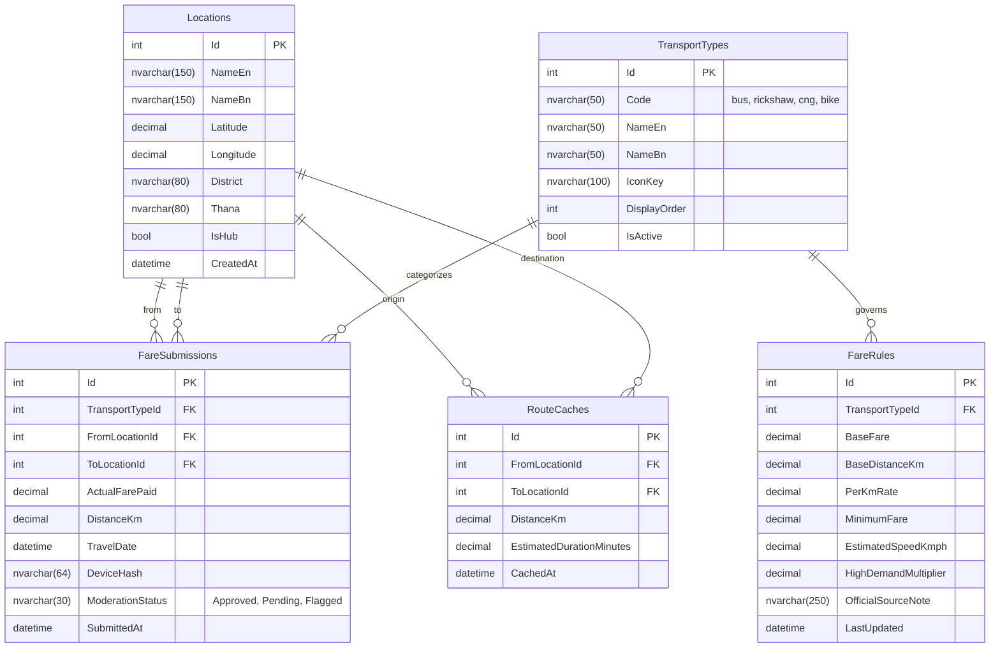

# VaraKoto.com — Simple & Smart Transport Fare Finder
## Comprehensive Architectural Blueprint & Phased Development Roadmap

---

## 1. Executive Summary & Project Vision

**VaraKoto.com** (গাড়ি ভাড়া কত?) is a modern, ultra-clean, mobile-first web application engineered to solve a daily frustration for millions of Bangladeshi commuters: **knowing how much a trip should reasonably cost, and sharing real fares paid.**

### Core Pillars
1. **Ultra-Simple Fare Discovery**: Select *From*, *To*, and *Transport Type* (Bus, Rickshaw, CNG, Bike) $\rightarrow$ Instantly view an accurate, transparent fare estimate, fare range, and distance.
2. **Community Crowd-Sourced Fares**: Commuters submit actual fares paid, building an organic, verified fare database that reflects real ground pricing.
3. **Radical Usability**: Minimalist, distraction-free interface, zero unnecessary text or complex navigation, blazing fast load times, and full bilingual support (English & Bengali).
4. **No Fluff, No Friction**: No forced user registration for checking fares or basic submission, no bloated third-party widgets, and an intuitive experience accessible to users of all technical proficiencies.

---

## 2. Design System & Asset Inspection

Inspection of the provided design packages reveals a distinct, culturally resonant visual identity:

### A. Branding Reference (`Logo system-html`)
- **Typography**: `Baloo Da 2` (Weights: 500, 700, 800) — friendly, rounded, highly legible Bengali and Latin script.
- **Brand Colors**:
  - **Forest Green** (`#0B4F44`): Primary brand color, conveys trust, reliability, and transport authority.
  - **Vibrant Orange** (`#E5570A`): Primary accent, CTA buttons, active state indicators.
  - **Sunny Yellow** (`#FFC93C`): Secondary accent, highlighting, badges, warning accents.
  - **Warm Cream** (`#FFF6E5`): Warm, paper-like light background, easy on the eyes.
  - **Deep Slate** (`#17302B`): Text primary, high-contrast borders, dark background accents.
- **Logo Visual Elements**:
  - Modern geometric sedan silhouette with rooftop taxi lightbox displaying a question mark (`?`).
  - Dual-wheel styling with yellow central hubs and deep slate outlines.
  - Logotype: **Vara** (Green `#0B4F44`) + **Koto** (Orange `#E5570A`) + **.com** (Slate `#17302B`).
  - Bangla subline: *গাড়ি ভাড়া কত?* (How much is the vehicle fare?).
  - Dark mode variant: Green background (`#0B4F44`), Cream text (`#FFF6E5`), and Yellow accent (`#FFC93C`).

### B. Loading Screen Reference (`Loading page-html`)
- **Concept**: A commuter scratching his head in puzzlement wondering about vehicle fares, transitioning into an "aha!" moment when the fare is found.
- **Key Animation Mechanics**:
  - Skyline silhouette footer (`#0B4F44` with 10% opacity).
  - Floating and drifting clouds (`drift` animation).
  - Puzzled character scratching head with rotating arm (`scratch`), bobbing body (`bob`), shifting gaze (`look`), and a falling sweat droplet (`drop`).
  - Floating colored question marks (`?`) in orange, yellow, and green.
  - Lightbulb illumination sequence (`bulb`) triggering above the character's head.
  - Swinging fare tag alternating between `"৳ ?"` and `"৳ ৫,০০০"`.
  - Continuous animated road track with moving dashed striping and a mini VaraKoto car driving across (`drive`).
  - Dynamic Bangla status progression:
    1. *গাড়ি খুঁজছি…* (Searching vehicles...)
    2. *ভাড়া মিলিয়ে দেখছি…* (Comparing fares...)
    3. *পেয়ে গেছি!* (Fare found!)
  - Built-in accessibility: full `@media (prefers-reduced-motion: reduce)` support.

---

## 3. Location, Routing & Fare Data Analysis for Bangladesh

### A. Location & Geocoding Evaluation
| Provider | Coverage & Accuracy (BD) | Cost / Limits | Technical Constraints | Recommendation |
| :--- | :--- | :--- | :--- | :--- |
| **Local Gazetteer (Pre-seeded DB)** | 100% for major hubs (Dhaka/Chittagong metros, thanas, bus stops) | **Free** ($0) | Limited to pre-seeded locations without fallback | **Primary for instant autocomplete** of known hubs |
| **Photon API (Komoot / OSM)** | Excellent for Bangladeshi place names (EN & BN), fuzzy matching | **Free**, no API key needed, fair-use | Requires bounding box filter (`bbox=88.0,20.5,92.7,26.7`) | **Secondary fallback** for granular addresses |
| **Nominatim (OpenStreetMap)** | Extensive POI data | **Free**, 1 req/sec strict rate limit | User-Agent required; rate limiting risk on burst traffic | Backend cached proxy only |
| **Google Places / Geocoding** | Best-in-class granular addresses | Paid: \$5-\$17 per 1K requests (after \$200 monthly tier) | High risk of unexpected costs for community projects | **Not recommended** for base MVP; optional enterprise plug-in |

> [!TIP]
> **Recommended Strategy**: A **Hybrid Geocoding Engine**:
> 1. Fast SQL Server local search for popular transit hubs (Mirpur 10, Farmgate, Shahbagh, Motijheel, Uttara, Dhanmondi, etc.) with Bengali synonyms.
> 2. Backend-proxied Photon/Nominatim with memory caching for arbitrary addresses, keeping external requests minimal and zero-cost.

### B. Routing & Distance Evaluation
- **OSRM (Open Source Routing Machine)**: Provides real road driving network distance and geometry. Completely free via public routing endpoints or self-hosted container.
- **Haversine Distance with Road Factor**: Dhaka city roads typically follow an empirical curvature factor of $1.28 \times \text{straight-line distance}$. Used as an instantaneous resilience fallback if external routing is temporarily unreachable.

### C. Bangladesh Fare Pricing Mechanics

#### 1. Bus (বাস)
- **Official Source**: Bangladesh Road Transport Authority (BRTA) Gazettes (2022-2024 revisions).
- **Metro Rate (Dhaka & Chittagong)**:
  - Minimum Fare: **৳20** (for large/regular city buses) / **৳10** (for minibuses).
  - Per Kilometer Rate: **৳2.45 - ৳2.50 per km**.
  - Long-distance / Inter-district: **~৳2.15 per km**.
- **Display**: "BRTA Official Gazette Fare" with indication of stoppage-based slab differences.

#### 2. CNG Auto-Rickshaw (সিএনজি অটোরিকশা)
- **Official BRTA Meter Policy**:
  - Base Fare (First 2 km): **৳40**.
  - Subsequent km: **৳12 per km**.
  - Waiting / Traffic charge: **৳2 per min**.
- **Real-World Reality (Contractual / "Chukti")**:
  - In Dhaka, meters are rarely honored; drivers negotiate trips starting at **৳150 - ৳200** for medium trips, averaging **৳25 - ৳35 per km**.
- **System Solution**: Show both values side-by-side:
  - *Official Meter Rate*: e.g. ৳85
  - *Typical Ground Negotiated Range*: e.g. ৳150 – ৳180
  - *Source*: "BRTA Meter Rule vs Commuter Average".

#### 3. Rickshaw (রিকশা)
- **Nature**: Unregulated, negotiated fare based on distance, weather, and traffic.
- **Market Empirical Rates (Dhaka)**:
  - Short-hop (up to 1 km): **৳20 - ৳30**.
  - Mid-range (1 - 3 km): **৳40 - ৳70**.
  - Long-range (3 - 6 km): **৳80 - ৳150**.
  - Average per-km rate: **~৳20 - ৳25/km**.
- **Display**: Reasonable range (e.g., ৳50 – ৳70) derived from distance calculation and verified community submissions.

#### 4. Bike / Ride-Sharing (পাঠাও / উবার মোটো)
- **Market Rates**:
  - Base Fare: **৳25 - ৳30**.
  - Per Kilometer Rate: **৳12 - ৳15/km**.
  - Time/Traffic buffer: **~৳0.50 - ৳1.00/min**.
  - Minimum Fare: **৳35 - ৳40**.
- **Display**: Standard ride-sharing estimate range (e.g., ৳95 – ৳120).

---

## 4. System Architecture

---

## 5. Database Schema Design (SQL Server)

---

## 6. Phased Development Roadmap

### Phase 1: Requirement Specification, Technical Feasibility & Solution Architecture
- **Objective**: Establish development standards, verify local tooling (.NET SDK, Node, Angular, SQL Server LocalDB), and scaffold the multi-project clean solution.
- **Detailed Tasks**:
  1. Initialize Git repository structure with proper `.gitignore` for .NET and Angular.
  2. Create the ASP.NET Core Web API solution (`VaraKoto.Api`, `VaraKoto.Core`, `VaraKoto.Infrastructure`).
  3. Initialize Angular frontend application with TypeScript and SCSS styling.
  4. Configure CORS, JSON formatting, and environment configurations.
- **Files Affected**:
  - `VaraKoto.sln`
  - `src/backend/VaraKoto.Api/*`
  - `src/backend/VaraKoto.Core/*`
  - `src/backend/VaraKoto.Infrastructure/*`
  - `src/frontend/varakoto-web/*`
- **Dependencies**: None.
- **Expected Outcome**: Clean, buildable .NET solution and Angular skeleton running without errors.
- **Testing & Verification**: `dotnet build` succeeds; `ng build` succeeds; test endpoint returns 200 OK.
- **Possible Risks**: Version mismatches between Node and Angular CLI; mitigated by pinned stable compatibility.

---

### Phase 2: Design System, Brand Identity & UI Components
- **Objective**: Translate `Logo system-html` and `Loading page-html` into high-fidelity, reusable Angular components, CSS variables, and dark/light mode themes.
- **Detailed Tasks**:
  1. Configure `Baloo Da 2` Google font and brand color tokens as CSS custom properties (`--vk-green`, `--vk-orange`, `--vk-yellow`, `--vk-cream`, `--vk-slate`).
  2. Implement `LogoComponent` supporting Light, Dark, App Icon, and Compact formats.
  3. Implement `LoadingScreenComponent` with all SVG keyframe animations (scratching character, lightbulb, floating `?`, swinging tag, driving car on dashed road, and Bangla status messages).
  4. Implement `ThemeService` for seamless Light/Dark mode toggling with local storage persistence.
  5. Add `@media (prefers-reduced-motion)` accessibility support.
- **Files Affected**:
  - `src/frontend/src/styles/_variables.scss`
  - `src/frontend/src/styles/_themes.scss`
  - `src/frontend/src/app/core/services/theme.service.ts`
  - `src/frontend/src/app/shared/components/logo/*`
  - `src/frontend/src/app/shared/components/loading/*`
- **Dependencies**: Phase 1.
- **Expected Outcome**: Beautiful, pixel-perfect logo and loading animations matching the design artifacts with zero third-party UI framework bloat.
- **Testing & Verification**: Visual comparison with `Logo.dc.html` and `Main.dc.html`; test light/dark toggle and responsiveness across screen widths (360px - 1440px).
- **Possible Risks**: Animation performance on low-end mobile devices; resolved via hardware-accelerated CSS `transform` and `opacity`.

---

### Phase 3: Database Design, EF Core & Backend Foundation
- **Objective**: Set up SQL Server database schema, EF Core migrations, and initial data seeding for Bangladesh locations and transport fare rules.
- **Detailed Tasks**:
  1. Configure `VaraKotoDbContext` with entities: `Location`, `TransportType`, `FareRule`, `FareSubmission`, `RouteCache`.
  2. Implement EF Core Fluent API mappings, indices, and constraints.
  3. Seed initial Bangladesh transport hubs (Dhaka & Chittagong prime transit points) with English & Bengali names.
  4. Seed BRTA official and realistic baseline fare calculation parameters for Bus, Rickshaw, CNG, and Bike.
  5. Apply migrations to `(localdb)\MSSQLLocalDB`.
- **Files Affected**:
  - `VaraKoto.Core/Entities/*`
  - `VaraKoto.Infrastructure/Data/VaraKotoDbContext.cs`
  - `VaraKoto.Infrastructure/Data/DbInitializer.cs`
  - `VaraKoto.Infrastructure/Migrations/*`
- **Dependencies**: Phase 1.
- **Expected Outcome**: Fully configured SQL Server database with initial seed data accessible via EF Core.
- **Testing & Verification**: `dotnet ef database update` executes cleanly; integration test retrieves seeded locations and transport types.
- **Possible Risks**: LocalDB connection string differences; mitigated by configurable connection strings in `appsettings.json`.

---

### Phase 4: Location Services, Geocoding & Routing Engine
- **Objective**: Build a robust, zero-cost location search, autocomplete, and distance routing engine for Bangladesh.
- **Detailed Tasks**:
  1. Build `LocationService` with hybrid search: priority search on pre-seeded local DB hubs + fallback to Photon API with Bangladesh bounding box.
  2. Support bilingual English and Bengali search terms (e.g., "Mirpur" / "মিরপুর").
  3. Implement `RouteService` utilizing OSRM road distance with Haversine geometric fallback.
  4. Implement `RouteCache` repository to store calculated distances and avoid redundant external calls.
  5. Expose REST endpoints: `GET /api/locations/search`, `GET /api/locations/detect-reverse`, `GET /api/routes/distance`.
- **Files Affected**:
  - `VaraKoto.Core/Interfaces/ILocationService.cs`
  - `VaraKoto.Infrastructure/Services/PhotonLocationService.cs`
  - `VaraKoto.Infrastructure/Services/OsrmRouteService.cs`
  - `VaraKoto.Api/Controllers/LocationsController.cs`
- **Dependencies**: Phase 3.
- **Expected Outcome**: Instant autocomplete for Bangladeshi locations and fast, accurate distance calculations.
- **Testing & Verification**: Query common routes (e.g., "Mirpur 10" to "Farmgate") and verify distance (~7-8 km) and coordinates.
- **Possible Risks**: Rate limiting or downtime of public OSRM/Photon; mitigated by DB distance caching and Haversine road-factor fallback.

---

### Phase 5: Transportation Fare Calculation Engine
- **Objective**: Implement accurate, transparent fare calculation domain logic for Bus, Rickshaw, CNG, and Bike.
- **Detailed Tasks**:
  1. Implement `IFareCalculationService` executing the verified Bangladesh calculation rules:
     - **Bus**: BRTA per-km rate, minimum fare slab (৳20), stopping slab estimations.
     - **Rickshaw**: Distance-based tier pricing, typical negotiated range.
     - **CNG**: Dual display: BRTA official meter rate vs ground reality negotiated range.
     - **Bike**: Ride-sharing baseline model (base + distance + duration buffer).
  2. Incorporate verified community submissions to refine fare ranges when available.
  3. Return comprehensive fare response: Estimated Fare / Range, Distance (km), Transport Type, Source / Reliability Indicator.
  4. Expose REST endpoint: `POST /api/fares/calculate`.
- **Files Affected**:
  - `VaraKoto.Core/Services/FareCalculationService.cs`
  - `VaraKoto.Core/DTOs/FareCalculationRequestDto.cs`
  - `VaraKoto.Core/DTOs/FareCalculationResultDto.cs`
  - `VaraKoto.Api/Controllers/FaresController.cs`
- **Dependencies**: Phase 3, Phase 4.
- **Expected Outcome**: Accurate, transparent fare results with clear distinction between official and community-estimated prices.
- **Testing & Verification**: Unit tests for all 4 transport types across short (1 km), medium (7 km), and long (25 km) journeys.
- **Possible Risks**: Misleading users about official vs actual fares; solved by clear labels and dual meter/contract displays.

---

### Phase 6: Core Frontend Homepage – Find Fare Interface
- **Objective**: Create the intuitive, distraction-free homepage where users discover fares in seconds.
- **Detailed Tasks**:
  1. Design clean, mobile-first card interface:
     - Starting Location input with auto-detect button and dropdown autocomplete.
     - Destination Location input with clean autocomplete.
     - Quick "Swap Locations" button.
     - Transport Selector: Bus, Rickshaw, CNG, Bike with custom SVG icons, vibrant selected states.
     - High-visibility "Find Fare" primary action button.
  2. Implement browser Geolocation API integration with polite permission prompt and reverse-geocoding into clean labels.
  3. Implement Fare Result Display card:
     - Clear fare amount / range in large, bold typography (`Baloo Da 2`).
     - Distance and estimated travel time tags.
     - Transport icon and name.
     - Source & reliability badge (e.g., "BRTA Official Rate", "Community Average").
  4. Integrate the animated loading screen during fare calculation.
- **Files Affected**:
  - `src/frontend/src/app/features/fare-finder/components/fare-finder-card/*`
  - `src/frontend/src/app/features/fare-finder/components/fare-result-card/*`
  - `src/frontend/src/app/features/fare-finder/pages/home-page/*`
  - `src/frontend/src/app/core/services/location.service.ts`
  - `src/frontend/src/app/core/services/fare.service.ts`
- **Dependencies**: Phase 2, Phase 4, Phase 5.
- **Expected Outcome**: Functional, polished homepage delivering fare estimates with zero cognitive friction.
- **Testing & Verification**: Test flow on mobile viewport (375px) and desktop; verify autocomplete selection, swap button, and result display.
- **Possible Risks**: Location permission denial; handled gracefully with manual text search.

---

### Phase 7: Community Fare Contribution & Verification System
- **Objective**: Build the community fare submission interface and moderation/outlier detection engine.
- **Detailed Tasks**:
  1. Frontend: Ultra-simple submission form: From, To, Transport Type, Actual Fare Paid (৳), optional travel date.
  2. Backend: `FareContributionService` with outlier validation:
     - Rejects unrealistic entries (e.g. ৳5 or ৳10,000 for standard city trips).
     - Calculates deviation from standard calculated fare.
     - Automatic verification for entries within reasonable confidence threshold.
  3. Anti-spam client fingerprinting (hashed IP + user agent) and rate-limiting (max 5 submissions per hour per client).
  4. Display community fare summaries on the result card (e.g., "Based on 14 recent commuter reports: ৳60 – ৳70").
  5. Expose REST endpoints: `POST /api/contributions`, `GET /api/contributions/recent`.
- **Files Affected**:
  - `src/frontend/src/app/features/community-fare/*`
  - `VaraKoto.Core/Services/FareContributionService.cs`
  - `VaraKoto.Api/Controllers/ContributionsController.cs`
- **Dependencies**: Phase 5, Phase 6.
- **Expected Outcome**: Community members can submit real fares; results enrich the main fare calculator.
- **Testing & Verification**: Submit valid and outlier fares; verify outlier flagging; verify rate limiting prevents spam submissions.
- **Possible Risks**: Troll or spam submissions; mitigated by automated IQR/boundary validation and rate limiting.

---

### Phase 8: End-to-End Integration, Validation & Anti-Spam Safeguards
- **Objective**: Ensure seamless interaction between all frontend components and backend services under various network conditions.
- **Detailed Tasks**:
  1. Comprehensive error handling: user-friendly Bengali & English error alerts for network drops, unresolvable routes, or empty search queries.
  2. Global HTTP error interceptor in Angular.
  3. API rate limiting on backend using ASP.NET Core RateLimiter middleware.
  4. Input sanitization and cross-site scripting (XSS) defense.
- **Files Affected**:
  - `src/frontend/src/app/core/interceptors/error.interceptor.ts`
  - `VaraKoto.Api/Middleware/ExceptionHandlingMiddleware.cs`
  - `VaraKoto.Api/Program.cs`
- **Dependencies**: Phase 6, Phase 7.
- **Expected Outcome**: Bulletproof stability, friendly error states, and secure API boundaries.
- **Testing & Verification**: Disconnect network, input malicious strings, and trigger rapid API bursts; verify system handles all scenarios safely.
- **Possible Risks**: Unhandled edge cases; addressed through global exception middleware and defensive UI state modeling.

---

### Phase 9: Testing, Responsiveness, Performance Optimization & Project Documentation
- **Objective**: Complete rigorous multi-device verification, audit bundle size, ensure rapid performance, and produce project hand-off documentation.
- **Detailed Tasks**:
  1. Responsive audit on iOS (Safari), Android (Chrome), and desktop browsers (Chrome, Edge, Firefox).
  2. Bundle size optimization in Angular (standalone tree-shaking, lazy loading, font subsetting).
  3. Backend response caching for static fare rules and popular location searches.
  4. Maintain living `PROJECT_PROGRESS.md` recording all completed milestones, architecture decisions, and operational notes.
- **Files Affected**:
  - `angular.json`
  - `PROJECT_PROGRESS.md`
  - `README.md`
- **Dependencies**: Phase 1 through 8.
- **Expected Outcome**: Blazing fast (<1.5s load), production-ready, beautifully responsive web app with complete documentation.
- **Testing & Verification**: Lighthouse performance and accessibility audit score $\ge 90$; multi-device touch testing.
- **Possible Risks**: Font loading delays on mobile 3G/4G networks; mitigated by preconnecting to Google Fonts and using `font-display: swap`.

---

## 7. Recommended Next Step

The logical starting point is **Phase 1: Requirement Specification, Technical Feasibility & Solution Architecture**.

Upon approval, Phase 1 will scaffold the .NET solution, initialize the Angular frontend, set up project structures, verify compiler toolchains, and prepare the clean foundation for the brand assets and UI components in Phase 2.
